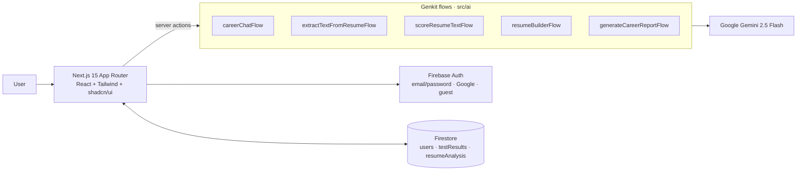

# CareerWise AI

**An AI career guidance platform** — take a career assessment, get your resume scored, chat with an AI career coach, build a resume, and get a personalised career report. Built with Next.js, Firebase and Google Gemini through Genkit.

## Architecture



## Features

- **AI career chat** — a Gemini-powered career coach that receives the conversation history with each message.
- **Resume analysis** — upload a PDF/DOCX; one Genkit flow extracts the text with Gemini, a second flow returns an ATS-style score (based on which key sections are present), feedback and detected skills.
- **Career assessment** — 35 multiple-choice questions across aptitude, personality and interests; results are saved to Firestore.
- **AI resume builder** — a form (experience, education, skills, projects) that Gemini turns into a two-column HTML resume, downloadable as PDF (jsPDF + html2canvas).
- **Dashboard** — profile completeness, latest ATS score, assessment results and skills charts (Recharts).
- **Career report** — combines assessment results and resume analysis into an overview, career matches, personality summary and current vs. missing skills.
- **Auth** — email/password, Google sign-in and guest (anonymous) login with Firebase Authentication; Firestore security rules in `firestore.rules`.
- **Typed AI I/O** — every flow has Zod input/output schemas.

## Tech stack

| Layer | Tools |
| --- | --- |
| Frontend | Next.js 15 (App Router), React 18, TypeScript, Tailwind CSS, shadcn/ui (Radix), React Hook Form, Recharts |
| AI | Genkit 1.20, `@genkit-ai/google-genai`, Gemini 2.5 Flash, Zod |
| Backend | Firebase Authentication, Cloud Firestore |
| Other | jsPDF, html2canvas, date-fns |

## Quick start

Needs Node.js 18+ and a Firebase project.

```bash
git clone https://github.com/prafulla2121/CareerWise-AI.git
cd CareerWise-AI
npm install

cp .env.example .env      # then add your GEMINI_API_KEY
npm run dev               # http://localhost:9002
```

Firebase setup:

1. Create a Firebase project and add a web app.
2. Put your web app config in `src/firebase/config.ts`.
3. In **Authentication**, enable Email/Password, Google and Anonymous sign-in.
4. Create a **Firestore** database and paste the rules from `firestore.rules`.

Other scripts:

```bash
npm run genkit:dev   # Genkit developer UI to run and inspect flows
npm run typecheck    # tsc --noEmit
npm run build        # production build
```

## Environment variables

| Variable | Purpose |
| --- | --- |
| `GEMINI_API_KEY` | Google AI Studio key, used by the Genkit Google AI plugin |

Firebase web config (not secret) lives in `src/firebase/config.ts`.

## Project structure

```
src/
  ai/
    genkit.ts            Genkit setup (Google AI plugin, Gemini 2.5 Flash)
    ai-career-chat.ts    career chat flow
    flows/               resume-analysis, resume-builder, report-generation
  app/
    (auth)/              login, signup
    (main)/              dashboard, chat, test, resume-upload, resume-builder, report, profile
  components/
    dashboard/           charts and overview cards
    layout/              header, sidebar, user menu
    ui/                  shadcn/ui components
  firebase/              config, auth helpers, Firestore hooks, error handling
  lib/                   utilities
docs/blueprint.md        original product blueprint
firestore.rules          Firestore security rules
```
